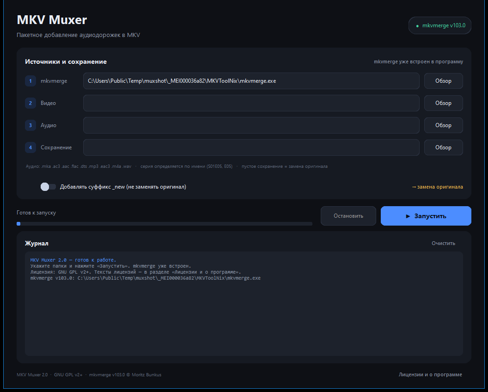

# MKV Muxer


**MKV Muxer** — настольная программа для Windows, которая пакетно добавляет аудиодорожки в MKV-файлы. Укажите папку с сериями и папку с аудио — программа сопоставит файлы по номеру серии и соберёт новые MKV.



## Возможности

- Пакетная обработка всех `.mkv` в выбранной папке.
- Автоматическое сопоставление видео и аудио по номеру серии.
- Три режима сохранения: в отдельную папку, рядом с суффиксом `_new`, замена оригинала.
- Прогресс, статус текущей серии и цветной журнал.
- Корректная остановка после текущего файла — без битых MKV.
- Тёмный интерфейс на CustomTkinter, русский язык.
- Portable-сборка одним `.exe` и установщик без прав администратора.

## Режимы сохранения

| Папка сохранения | Суффикс `_new` | Результат |
|---|---|---|
| указана | не важно | готовые файлы пишутся в эту папку с теми же именами |
| пуста | включён | рядом с оригиналом создаётся `..._new.mkv` |
| пуста | выключен | оригинал заменяется (программа попросит подтверждение) |

В режиме замены сначала создаётся временный файл, и только после успешной обработки он подменяет оригинал. Если папка сохранения совпадает с папкой видео, включите `_new` или выберите другую папку.

## Определение серии

Серия извлекается из имени файла без расширения, регистр не важен:

| Пример | Номер |
|---|---|
| `Show.S01E05.1080p.mkv` | 05 |
| `Show E05.mkv` | 05 |
| `Show_Ep05.mkv` | 05 |
| `Show - Episode 5.mkv` | 05 |
| `Show - 05.mkv` | 05 |
| `Show_05.mkv` | 05 |

Если явного маркера нет, берётся последнее отдельное число из 1–3 цифр, ограниченное пробелом, точкой, дефисом, подчёркиванием или краем имени. Номера приводятся к двум цифрам: `5` → `05`.

Видео и аудио сопоставляются по этому номеру. Если для серии нет аудио или номер не найден, файл пропускается с сообщением в журнале. Если на одну серию приходится несколько аудиофайлов, используется первый по алфавиту, остальные отмечаются предупреждением.

## Поддерживаемые аудиоформаты

`.mka`, `.ac3`, `.aac`, `.flac`, `.dts`, `.mp3`, `.eac3`, `.m4a`, `.wav`

Новая дорожка добавляется к существующим дорожкам MKV. Видео и субтитры не перекодируются — пересобирается контейнер.

## Структура проекта

```text
.
├─ mkv_muxer.py              исходный код (GPL-2.0-or-later)
├─ app.ico                   иконка приложения
├─ MKV_Muxer.spec            сборка onefile (portable)
├─ MKV_Muxer_onedir.spec     сборка onedir (установщик)
├─ build_release.ps1         полная сборка одной командой
├─ installer\
│  └─ MKV_Muxer.iss          сценарий Inno Setup
├─ LICENSES\                 тексты лицензий и notices
├─ docs\
│  └─ screenshot.png         скриншот для README
├─ README.txt                краткая инструкция внутри сборок
└─ SIGNING.md                как подписать EXE и установщик
```

## Подпись и SmartScreen

Сборки не подписаны. Windows SmartScreen может показать «Неизвестный издатель», а антивирус — ложное срабатывание на PyInstaller-сборку. Подробная инструкция по сертификату, `signtool` и настройке Inno Setup находится в [`SIGNING.md`](SIGNING.md).

Контрольные суммы готовых файлов лежат в `release\SHA256SUMS.txt`; проверка:

```powershell
Get-FileHash .\release\MKV_Muxer_1.0_setup.exe -Algorithm SHA256
```

## Лицензия

Код программы распространяется под **GNU General Public License v2.0 или новее** (`GPL-2.0-or-later`). Полный текст — в файлах [`LICENSE`](LICENSE) и [`LICENSES/GPL-2.0.txt`](LICENSES/GPL-2.0.txt).

Сторонние компоненты и их лицензии перечислены в [`LICENSES/THIRD_PARTY_NOTICES.txt`](LICENSES/THIRD_PARTY_NOTICES.txt). При распространении сборок вместе с ними необходимо передавать исходный код: он находится в этом репозитории и входит в portable-архив и установщик.

## Благодарности

- [MKVToolNix](https://mkvtoolnix.download/) — формат MKV и утилиты для работы с ним.
- [CustomTkinter](https://github.com/TomSchimansky/CustomTkinter) — интерфейс.
- [PyInstaller](https://pyinstaller.org/) — сборка Windows-исполняемых файлов.
- Python, Tcl/Tk и Inno Setup.
